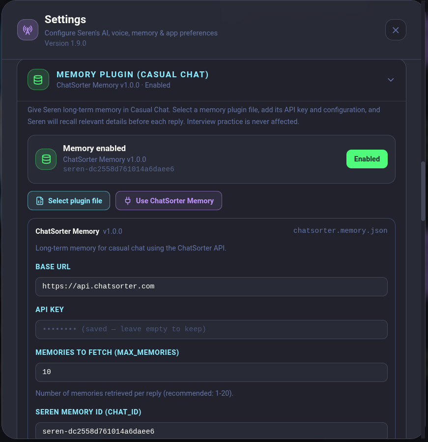

<div align="center">


# Seren — Your IELTS Tutor

**Your personal AI IELTS speaking coach** — practice speaking, get instant CEFR evaluation, and improve with personalized lesson plans.

[](https://react.dev/)
[](https://www.typescriptlang.org/)
[](https://tailwindcss.com/)
[](https://vitejs.dev/)
[](https://nodejs.org/)
[](https://web.dev/progressive-web-app/)
[](https://github.com/Mahmud-Mahi/Seren--Your-IELTS-Tutor/releases/latest)
[](https://github.com/Mahmud-Mahi/Seren--Your-IELTS-Tutor/releases)

**📥 [Download the latest release](https://github.com/Mahmud-Mahi/Seren--Your-IELTS-Tutor/releases/latest) · 📧 [mahmudurahmanmahi26@gmail.com](mailto:mahmudurahmanmahi26@gmail.com)**

</div>

---

## ✨ Features

### 🎤 Full Diagnostic Test
Complete Cambridge IELTS-style speaking assessment across all three parts:
- **Part 0** — Examiner's introduction & identity check (examined, never scored)
- **Part 1** — Introduction & familiar topics (4-5 questions)
- **Part 2** — Cue card with 1-minute preparation
- **Part 3** — Abstract discussion & follow-up questions

Each part opens with the real examiner transition line (`Now, in this first part
I'd like to ask you some questions about yourself.` / the cue-card instructions /
the discussion link) and the test closes with `Thank you. That is the end of the
speaking test.` before the report is generated.

### 📊 AI-Powered Evaluation
Instant detailed scoring across four IELTS pillars:

| Pillar | What's Assessed |
|--------|----------------|
| **Fluency & Coherence** | Smoothness, pacing, logical flow |
| **Lexical Resource** | Vocabulary range, precision, idiomatic language |
| **Grammatical Range** | Sentence structures, error frequency, complexity |
| **Pronunciation** | Clarity, stress, intonation, individual sounds |

### 📈 Score Report
- Predicted IELTS band score (0-9)
- CEFR level assessment (A1-C2)
- Strengths & growth areas per pillar
- Upgraded expressions with band-level alternatives
- Pronunciation tips with IPA transcriptions
- Speech statistics (WPM, pause fluency, vocabulary variety)

### 📚 Personalized Lesson Studio
AI-generated lesson roadmap tailored to your weaknesses:
- Rapid fire drills
- Cue card practice
- Lexical boost exercises
- Shadowing sessions
- Mock exam simulations

### 💬 1v1 Chat Practice
Two practice modes:
- **Casual Chat** — Free conversation on everyday topics
- **Interview Mode** — Full IELTS Part 1 simulation: the Part-0 identity check
  (with Hint model answers, never scored), then the random 2–3-topic question set
  that mirrors how many questions the chosen topic holds, closed by the examiner

### 🔊 Real-Time Voice
- **Speech-to-Text**: Local offline Whisper (sherpa-onnx) with a live mic equalizer in the input box
- **Text-to-Speech**: Microsoft Edge Neural TTS with browser fallback
- Seren speaks questions aloud and listens to your answers

### 📱 Progressive Web App
- Installable on desktop & mobile

---

## 📸 Preview

### 🔐 Sign in

| Continue with Google | Email & Password |
| --- | --- |
|  |  |

### 🎤 Cambridge Speaking Test

| Part 0 — Introduction & Identity Check | Part 1 — Introduction & Lifestyle |
| --- | --- |
|  |  |

| Part 2 — Cue Card | Part 3 — Two-Way Discussion |
| --- | --- |
|  |  |

### 📊 Score Report

| Evaluation | Report History |
| --- | --- |
|  |  |

### 📚 Lessons, Chat & Solutions

| Personalized Lesson Studio | 1v1 Chat |
| --- | --- |
|  |  |

| Cambridge Solutions · Live with Seren | Your Preferences |
| --- | --- |
|  |  |

### ⚙️ Settings

| AI Providers & Cascade Priority | Providers, Models & DemonRoute |
| --- | --- |
|  |  |

| ChatSorter Memory Plugin | Voice, Display & Data |
| --- | --- |
|  |  |

| Keyboard Shortcuts | |
| --- | --- |
|  | |

---

## 📥 Download

Grab the latest installer from the **[Releases page](https://github.com/Mahmud-Mahi/Seren--Your-IELTS-Tutor/releases/latest)** — no terminal and no Node.js install required.

| Platform | Installer | How to install |
|----------|-----------|----------------|
| 🪟 **Windows** 10/11 (x64) | [`Seren-Setup-2.0.0.exe`](https://github.com/Mahmud-Mahi/Seren--Your-IELTS-Tutor/releases/download/v2.0.0/Seren-Setup-2.0.0.exe) | Run the installer — per-user install, no admin prompt. It is unsigned, so SmartScreen may warn on first launch. |
| 🐧 **Linux** (Debian / Ubuntu / Kali) | [`seren_2.0.0_amd64.deb`](https://github.com/Mahmud-Mahi/Seren--Your-IELTS-Tutor/releases/download/v2.0.0/seren_2.0.0_amd64.deb) | `sudo apt install ./seren_2.0.0_amd64.deb` |
| 📦 **All versions** | [Releases](https://github.com/Mahmud-Mahi/Seren--Your-IELTS-Tutor/releases) | Full release history, each with notes and checksums |

> 🎙️ Every installer **bundles the offline Whisper speech model** (~280 MB), so the first launch needs no extra download.
>
> 📧 Questions, feedback or a bug report? [mahmudurahmanmahi26@gmail.com](mailto:mahmudurahmanmahi26@gmail.com)

---

## 🆕 What's New in 2.0.0

> 🚀 Everything below is new since **v1.7.9** — the previous published release.

### ✨ Added

- 🧠 **ChatSorter long-term memory** — Casual Chat can now remember you across conversations. Pick the bundled ChatSorter plugin (or load your own `.json` memory plugin), add its API key, base URL, chat ID and memory count, then let Seren recall relevant details before every reply. Interview practice is never affected. Your existing Casual Chat history is synced once on the first successful connection test, and the whole config lives in a collapsible card in Settings.
- 🛣️ **DemonRoute provider** — a fourth OpenAI-compatible LLM provider with the default API URL `https://api.demonroute.com/v1`, automatic model discovery, a model dropdown, and a direct link to get a key at [demonroute.com](https://demonroute.com).
- 🎛️ **Manual cascade priority** — Auto (smart cascade) is now one collapsible card. Expand it to include/exclude providers, move them up or down, and reset to the default order. The order is persisted in `seren-settings.json` and is used exactly as configured by the Auto cascade.
- 🎙️ **Refreshed TTS voice catalog** — extra Google, Azure and Amazon Polly voices, with per-provider voice selection that persists locally and syncs through Firestore. Google remains free with no setup.
- 🧑‍🏫 **Male examiner voice** — Cambridge Solutions now asks questions with a male examiner voice from the selected TTS provider instead of a fixed Edge voice.
- ⚙️ **Settings refresh** — the modal is now simply **Settings**, with a descriptive subtitle, a compact collapsible cascade card, an always-visible model dropdown for every provider, and a collapsible ChatSorter memory card.

### 🐛 Fixed

- 🔊 **Voice preferences survive restarts** — per-provider voice choices no longer disagree between localStorage, `seren-settings.json` and Firestore; the server value is authoritative with a local fallback.
- 💬 **Memory-aware Casual Chat** — memory retrieval and storage are wired into the chat endpoint, while the opening greeting explicitly skips memory writes.
- 📜 **Long lesson replies stay readable** — Seren's speech bubble in Lesson Studio can scroll instead of overflowing the layout.
- 🔁 **Correct resume greeting** — returning to a saved lesson restores its previous Seren message and greets you once, instead of showing an empty or duplicated bubble.
- 📐 **Solutions pane stays on screen** — dragging the Cambridge Solutions scroll area no longer lets it grow past the bottom of the viewport.
- 🌐 **Provider health checks** — DemonRoute and Groq are both treated as key-required providers for status, model listing and the auto cascade.
- 🧭 **Persistent memory settings** — saving other settings no longer wipes the ChatSorter configuration, and factory reset clears it together with the rest of the app.
- 🖼️ **Updated settings previews** — the README now shows the new AI provider/cascade and ChatSorter memory screens.

### 📦 Downloads
- 🪟 Windows: `Seren-Setup-2.0.0.exe`
- 🐧 Debian/Ubuntu: `seren_2.0.0_amd64.deb`

### 🔐 Checksums (SHA-256)
```text
b01e3b469ea2e692c5f60635f90e8852081789d6b5eaf99137bfba564284c2d6  Seren-Setup-2.0.0.exe
91e603656473a264ea6efd5465d4cf0600667b8383a378fa9e1d6878e5a32681  seren_2.0.0_amd64.deb
```

---

## 🚀 Quick Start

### Prerequisites
- [Node.js](https://nodejs.org/) 18+
- A microphone for voice practice

### Installation

```bash
git clone https://github.com/Mahmud-Mahi/Seren--Your-IELTS-Tutor.git
cd Seren--Your-IELTS-Tutor
npm install
cp .env.example .env
```

### Configure LLM Provider

Edit `.env` with your preferred provider. Seren uses a **cascading fallback** system:

```env
# Option 1: Local LLM (LM Studio, llama.cpp, LiteLLM, vLLM)
LLM_BASE_URL=http://localhost:3456/v1
LLM_MODEL=auto
LLM_API_KEY=none

# Option 2: Ollama (free, runs locally)
OLLAMA_BASE_URL=http://localhost:11434/v1
OLLAMA_MODEL=ornith:9b

# Option 3: Groq Cloud (free tier, no credit card)
GROQ_API_KEY=your_groq_api_key_here
GROQ_MODEL=openai/gpt-oss-120b

# Option 4: DemonRoute (OpenAI-compatible provider)
DEMONROUTE_API_KEY=your_demonroute_api_key_here
DEMONROUTE_BASE_URL=https://api.demonroute.com/v1
DEMONROUTE_MODEL=auto

# Provider priority order (also editable in Settings → Auto smart cascade)
PROVIDER_PRIORITY=local,ollama,groq,demonroute
```

> **No API key? No problem!** Configure everything at runtime through the in-app Settings panel.

### Run the App

**Development** (runs the Express backend + serves the React frontend):

```bash
npm run dev
```

**Production**:

```bash
npm run build
npm start
```

The app will be available at **http://localhost:3000** (or the `PORT` you configured).

> 💡 **Completely free & better performance — no API key needed!** Use my other repo [token-free-gateway](https://github.com/Mahmud-Mahi/token-free-gateway) — a lightweight AI gateway that exposes an OpenAI-compatible interface with full Tools support, using web AI sessions instead of API tokens. Point Seren's `LLM_BASE_URL` at it and enjoy free, unlimited LLM access:

```env
LLM_BASE_URL=http://localhost:3456/v1
LLM_MODEL=auto
LLM_API_KEY=none
```

---

## ☁️ Cloud Sync & Google Sign-In

Seren signs you in with your **Google account**, and every lesson, report,
transcript and draft is saved against it — so a lesson started on your laptop
can be finished on your phone.

| | |
|---|---|
| **Setup guide** | [`docs/FIREBASE-SETUP.md`](docs/FIREBASE-SETUP.md) |
| **Cost** | Free — [Firebase Spark plan](https://firebase.google.com/pricing), no credit card |
| **What you must configure** | Your own Firebase project (~10 minutes, one time) |
| **What your users must configure** | **Nothing.** Sign-in works out of the box |

Data is written to the account **as you work** (offline-first): the local copy
is saved instantly and mirrored to the cloud in the background, so a dropped
connection never costs you a lesson.

> **No Firebase project? Seren still works.** Without cloud sync configured it
> runs in offline mode — everything stays on the device, and the sign-in
> screen says so.

### How the sign-in works

Google refuses to show its OAuth consent screen inside an embedded user agent
(Electron), so Seren opens it in your **real browser** and listens on
`localhost` for the redirect. The whole exchange happens on your own machine —
no server of yours is involved, and no password is ever handled by Seren.

Firebase Auth owns the session (including refresh and revocation), and
Firestore Security Rules (`firestore.rules`) are what actually keep each
learner's data private:

```
match /users/{userId}/{document=**} {
  allow read, write: if request.auth != null && request.auth.uid == userId;
}
```

---

## 🔐 Security

### What is public, and what actually protects your data

| Value | Public? | Why it is safe (or not) |
|---|---|---|
| Firebase **web** config (`apiKey`, `projectId`, `appId`) | ✅ Public by design | It ships inside every Firebase web app in the world. It only *identifies* the project — it cannot grant IAM roles, deploy rules, or reach the Admin API. Access is decided by **Firestore Security Rules**, not by hiding the key. |
| OAuth **desktop** client id / secret | ✅ Effectively public | A desktop app is a **public client** (RFC 8252 §8.4) — the secret ships inside every install of the app, so it "should not be treated as confidential". PKCE is what actually protects the flow. |
| **Firestore Security Rules** | 🔒 The real boundary | One rule locks every learner into their own `users/{uid}/**` folder. Even a signed-in attacker cannot read or write anyone else's data. |
| **Service-account key** (`*-firebase-adminsdk-*.json`) | 🔒 **Never commit** | This one *would* grant full Admin access to the whole project. It is gitignored and must never be shared. |
| **Paid provider keys** (`GROQ_API_KEY`, `ASSEMBLYAI_API_KEY`) | 🔒 **Never commit or ship** | A key in the repo (or baked into a published installer) would be billable to whoever uses it. `npm run app:inspect` fails the build if one leaks into a packaged app. |

### Verified against the live project

The published config was tested directly — with **only** the API key, an attacker gets:

| Attempt | Result |
|---|---|
| List every Firestore document | `403 PERMISSION_DENIED` |
| Read another learner's document | `403 PERMISSION_DENIED` |
| List all user accounts (Admin API) | blocked |
| Read the project configuration | blocked |

Signing in does not widen this: a signed-in token still only reaches its own folder.

### Protecting your own project

If you fork Seren and point it at your own Firebase project:

1. **Never commit a service-account key.** `.gitignore` already blocks the common names.
2. **Keep `client_secret_*.json` local.** It is now gitignored as well — put the values in `.env` instead.
3. **Deploy the rules.** `firebase deploy --only firestore:rules` — an undeployed ruleset is the one state where data is exposed.
4. **Rotate a leaked secret.** If a service-account key or the OAuth secret is ever committed, rotate it in the Google Cloud console — deleting the commit is not enough.
5. **Consider App Check** for extra protection against automated abuse of the public API key.

---

## 🖥️ Desktop App

Seren also runs as a **standalone desktop app** — its own window and launcher icon, no terminal and no browser tab. Electron is only a *shell*: it boots the exact same Express backend (`dist/server.cjs`) on **Electron's built-in Node runtime**, so no system Node.js is needed at runtime, then opens the UI at `http://127.0.0.1:<port>`.

```bash
npm run app:start     # build + open the desktop window
npm run app:dev       # desktop window attached to a running `npm run dev` (hot reload)
npm run dev:watch     # auto-restart the backend when src/server/* changes
```

The packaged desktop executable also provides command-line information without
opening the application window:

```bash
seren --version       # print the installed version
seren --help          # show command-line options
```

For an unpacked Linux build, run `./release/linux-unpacked/seren --version` or
`./release/linux-unpacked/seren --help`.

### Build installers

```bash
npm run app:dist      # Linux   → release/seren_<version>_amd64.deb
npm run app:dist:win  # Windows → release/Seren-Setup-<version>.exe  (cross-built with wine)
npm run app:dist:all  # both in one go
npm run app:inspect   # list what actually got packaged (files, deps, secrets, size)
npm run app:dist:mac  # macOS .dmg — must be run ON macOS
```

Each build is also **runnable without installing**: `./release/linux-unpacked/seren`.

> **First run note:** Electron 44 ships its downloader as a separate bin (no `postinstall`), so after `npm install` run `npx install-electron` once if `electron .` complains about a missing binary. Building installers does not need it — electron-builder fetches Electron itself.

### Install (Debian / Ubuntu / Kali)

```bash
sudo apt install ./release/seren_*_amd64.deb       # menu entry + /usr/bin/seren
sudo apt remove seren                              # uninstall (your data is preserved)
```

Verify the generated dependencies resolve on your distro *before* installing:

```bash
dpkg-deb -I release/*.deb | grep -A2 Depends
apt-get -s install ./release/*.deb        # read-only simulation
```

### Where your data lives

The installed app bundle is read-only, so everything writable lives in the OS app-data folder:

| Platform | Folder |
|----------|--------|
| Linux | `~/.config/Seren/` |
| Windows | `%APPDATA%\Seren\` |
| macOS | `~/Library/Application Support/Seren/` |

| File | Contents |
|------|----------|
| `seren-settings.json` | API keys, provider pinning, models, voice (on first desktop launch it is **imported once** from the project root if present) |
| `seren-server.log` | Full startup + backend log — the first place to look when something fails (also in the app's Help menu) |
| `models/` | Whisper STT model (~280 MB full-precision `base.en`; copied from the installer on first launch, auto-downloaded only if missing) |
| `.env` | Optional: put `GROQ_API_KEY`, `LLM_BASE_URL`, `OLLAMA_BASE_URL`, … here for the desktop app |

### Moving your browser data into the desktop app

The app keeps onboarding/profile/preferences in localStorage, which is **per-browser** — the desktop app starts with a fresh profile even if you used Seren in Chrome. Your **settings file** (API keys, provider, voice) is imported automatically on first launch.

The easiest way to carry the rest over is built into the app: **Settings → Your Data → Export backup** in the browser app, then **Import backup** in the desktop app. The backup is a plain JSON file containing every `seren_*` key (profile, reports, lessons, chats, preferences). For raw LevelDB extraction there are two one-time scripts:

```bash
node scripts/migrate-browser-data.cjs    # extract seren_* data from Chrome/Chromium/Brave/Edge (read-only)
node scripts/import-browser-data.cjs --port 9444   # inject into the running desktop app + verify
```

Run the second command while the desktop app is open **with a debug port**, e.g.:

```bash
./release/linux-unpacked/seren --remote-debugging-port=9444
```

It reloads the window and verifies every key, so you see exactly what was carried over (profile, preferences, history). The extractor parses Chrome's LevelDB properly — 32 KB log block framing, snappy-compressed `.ldb` table blocks, prefix-compressed keys — and also picks up data the desktop app wrote under an old `http://127.0.0.1:<port>` origin.

### Desktop behaviour worth knowing

- **Stable origin** — the window always loads the fixed `seren://app` origin, which the shell transparently proxies to whichever loopback port the backend picked. localStorage is origin-scoped, so chat history, reports and lessons can never be stranded by a port change. **Settings → Display Size** provides independent whole-UI zoom (including images) and text-only scaling, while **Settings → Your Data** provides JSON backup and restore.
- **Ports** — the app prefers `3000` and automatically falls back to a free port if it is busy, so the `EADDRINUSE` failure can no longer block startup. If a Seren server is already running on 3000, the window attaches to it instead of starting a second one.
- **Network** — the desktop shell binds the backend to `127.0.0.1` only, so your API keys are never reachable from the LAN (the browser workflow keeps the previous `0.0.0.0` behaviour).
- **Closing the window quits the app** (all platforms), including the backend process — no invisible server left behind.
- **An LLM is still required** (Groq free tier or a local Ollama/LM Studio). The desktop app does not remove that; configure it in Settings or `.env`.
- **Offline speech-to-text needs `ffmpeg` on `PATH`** — the local Whisper engine decodes through it. Cloud STT (Groq Whisper, the default in Settings) needs no external binary, and Seren falls back automatically when `ffmpeg` is missing.
- **Linux sandbox error on launch?** (`The SUID sandbox helper binary was found, but is not configured correctly`) run the unpacked build with `--no-sandbox`, or install the `.deb`, which sets the sandbox helper up correctly.
- **Windows** shows a SmartScreen warning on first run because the installer is unsigned; add a code-signing certificate under `win.signtoolOptions` to remove it.

### Extending the desktop app

`electron/main.cjs` is the shell (window, ports, permissions, shutdown) and `electron-builder.yml` decides what ships. Both are written so normal development needs **no** packaging changes — adding React code, backend routes, question data or ordinary npm dependencies requires nothing at all. For the two cases that do need a line (a new on-disk runtime asset, or a native module), see [`electron-resources/README.md`](electron-resources/README.md).

---

## 🏗️ Architecture

```
┌──────────────────────────────────────────────────────────┐
│                    Frontend (React)                      │
│  ┌──────────┐ ┌──────────┐ ┌──────────┐ ┌──────────┐     │
│  │Diagnostic│ │  Score   │ │  Lesson  │ │   1v1    │     │
│  │   Test   │ │  Report  │ │  Studio  │ │   Chat   │     │
│  └──────────┘ └──────────┘ └──────────┘ └──────────┘     │
│          Mic equalizer → MediaRecorder (Whisper STT)     │
└─────────────────────────┬────────────────────────────────┘
                          │ HTTP / REST
┌─────────────────────────┴────────────────────────────────┐
│                  Backend (Express)                       │
│  ┌──────────────────────────────────────────────────┐    │
│  │            LLM Provider Cascade                  │    │
│  │  Local → Ollama → Groq → DemonRoute              │    │
│  │  Auto cascade fallback, user-defined order       │    │
│  └──────────────────────────────────────────────────┘    │
│  ┌─────────────────┐  ┌─────────────────────────────┐    │
│  │   Whisper STT   │  │  Google / Azure / Polly TTS │    │
│  │  (sherpa-onnx)  │  │  + memory plugin (Casual)   │    │
│  └─────────────────┘  └─────────────────────────────┘    │
└──────────────────────────────────────────────────────────┘
```

---

## ⚙️ Configuration

### LLM Providers

| Provider | Description | Setup |
|----------|-------------|-------|
| **Local** | Self-hosted LLM via OpenAI-compatible API | Set `LLM_BASE_URL` to your server |
| **Ollama** | Run open-source models locally | Install [Ollama](https://ollama.com) |
| **Groq** | Free cloud API (no credit card) | Get key at [console.groq.com](https://console.groq.com) |
| **DemonRoute** | OpenAI-compatible provider with model discovery | Get a key at [demonroute.com](https://demonroute.com); default URL is `https://api.demonroute.com/v1` |
| **[token-free-gateway](https://github.com/Mahmud-Mahi/token-free-gateway)** | Free OpenAI-compatible gateway using web AI sessions — no API tokens required | Run the gateway locally and set `LLM_BASE_URL` to it |

The **Auto (smart cascade)** card in Settings lets you choose which providers participate and in what order. When a provider is pinned, the priority list is bypassed.

### Environment Variables

| Variable | Default | Description |
|----------|---------|-------------|
| `LLM_BASE_URL` | `http://localhost:3456/v1` | Local LLM server URL |
| `LLM_MODEL` | `auto` | Model ID or `auto` for auto-detect |
| `OLLAMA_BASE_URL` | `http://localhost:11434/v1` | Ollama server URL |
| `OLLAMA_MODEL` | `ornith:9b` | Ollama model name |
| `GROQ_API_KEY` | — | Groq API key |
| `GROQ_MODEL` | `openai/gpt-oss-120b` | Groq model ID |
| `DEMONROUTE_API_KEY` | — | DemonRoute API key |
| `DEMONROUTE_BASE_URL` | `https://api.demonroute.com/v1` | DemonRoute API base URL |
| `DEMONROUTE_MODEL` | `auto` | DemonRoute model ID |
| `DEMONROUTE_TIMEOUT_MS` | `180000` | DemonRoute request timeout |
| `PROVIDER_PRIORITY` | `local,ollama,groq,demonroute` | Fallback order (also editable in Settings) |
| `TTS_ENABLED` | `true` | Enable text-to-speech |
| `TTS_VOICE` | `en-US-JennyNeural` | Edge TTS voice ID |
| `PORT` | `3000` | Server port |

---

## 📁 Project Structure

```
├── src/
│   ├── components/          # React UI components
│   │   ├── AccountGate.tsx        # Sign-in screen (Google + email)
│   │   ├── CambridgeTest.tsx     # Cambridge IELTS test flow
│   │   ├── CambridgeSolutions.tsx # Model answers & "what to notice"
│   │   ├── EvaluationReport.tsx  # Score report with tabs
│   │   ├── LessonStudio.tsx      # Personalized lesson modules
│   │   ├── SerenLiveChat.tsx     # 1v1 chat & interview mode
│   │   ├── UserPref.tsx          # Profile & coaching preferences
│   │   ├── SettingsModal.tsx     # Provider, voice & data config
│   │   └── ...
│   ├── auth/                # Firebase session + cross-device sync engine
│   │   ├── session.ts       # Sign-in, sign-out, password reset
│   │   ├── sync.ts          # Storage interceptor, debounce, merge
│   │   └── cloud-sync.ts    # Firestore read/write transport
│   ├── autosave/            # Per-feature autosave (lessons, solutions, drafts)
│   ├── firebase/            # Firebase client singletons + config
│   ├── utils/
│   │   ├── speech.ts        # TTS, STT, sound effects
│   │   ├── evaluation.ts    # LLM response normalization
│   │   ├── greetings.ts     # AI greeting generation
│   │   └── ...
│   ├── server/              # Express backend modules
│   │   ├── llm.ts           # Provider cascade, DemonRoute, priority order
│   │   ├── memory.ts        # ChatSorter / custom memory plugin engine
│   │   └── routes/          # API routes (providers, memory, lessons, TTS, …)
│   ├── data/                # IELTS question banks
│   ├── types.ts             # TypeScript interfaces
│   └── App.tsx              # Main application
├── server.ts                # Dev entry (thin boot file → src/server/index.ts)
├── plugins/                 # Bundled memory plugin manifests
│   └── chatsorter.memory.json
├── stt-whisper.cjs          # sherpa-onnx Whisper STT binding
├── electron/                # Desktop shell (main.cjs, preload.cjs, splash)
├── public/                  # Static assets & PWA manifest
├── assets/                  # IELTS test data (JSON)
├── docs/                    # Firebase setup guide
├── firestore.rules          # Per-user data isolation rules
├── firebase.json            # Firebase hosting + rules config
└── .env.example             # Environment template
```

---

## 🛠️ Tech Stack

| Layer | Technology |
|-------|------------|
| **Frontend** | React 19, TypeScript, Tailwind CSS 4, Motion |
| **Build** | Vite 6, esbuild |
| **Backend** | Express.js, Node.js |
| **LLM** | OpenAI-compatible API (Local / Ollama / Groq / DemonRoute) with manual cascade order |
| **STT** | sherpa-onnx Whisper (local) + live mic equalizer |
| **TTS** | Google, Azure, Amazon Polly, Microsoft Edge Neural TTS, SpeechSynthesis |
| **Memory** | ChatSorter plugin API or custom `.memory.json` plugin (Casual Chat only) |
| **PWA** | Service Worker, Web App Manifest |

---

## 🤝 Contributing

Contributions are welcome! Feel free to open issues or submit pull requests.

---

## 📬 Contact

Questions, feedback, or just want to say hi? Reach out!

📧 **Email**: [mahmudurahmanmahi26@gmail.com](mailto:mahmudurahmanmahi26@gmail.com)

🐙 **GitHub**: [@Mahmud-Mahi](https://github.com/Mahmud-Mahi) · 📦 **Downloads**: [Releases](https://github.com/Mahmud-Mahi/Seren--Your-IELTS-Tutor/releases)

---

## 📄 License

This project is licensed under the **MIT License** — see the [LICENSE](LICENSE) file for details.

[](https://github.com/Mahmud-Mahi/Seren--Your-IELTS-Tutor/blob/master/LICENSE)

> The MIT License text is available on GitHub: [choosealicense.com/licenses/mit](https://choosealicense.com/licenses/mit/) · [GitHub's MIT license template](https://github.com/licenses/license-mit)

---

<div align="center">

Made with ❤️ for IELTS learners worldwide

</div>
